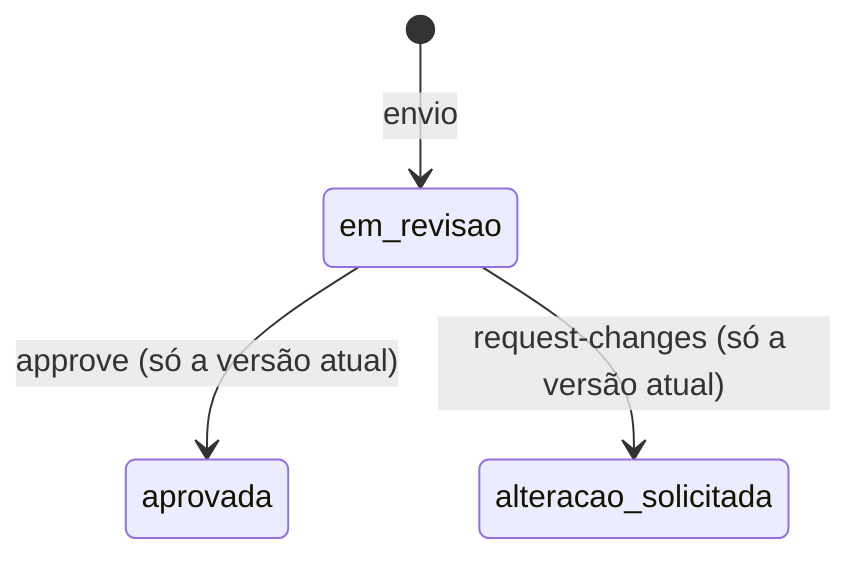
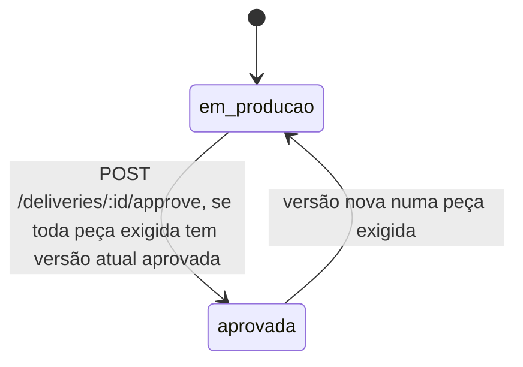

# Revisão de vídeo

API para revisar as peças de uma entrega de criador: versões numeradas, comentário preso a um segundo do vídeo e a regra de que a entrega só é aprovada (e só fica pagável) quando cada peça que a campanha exige tem a versão atual aprovada.

O modelo foi desenhado antes do código em [`docs/design.md`](docs/design.md), com entidades, estados, invariantes e a revisão do design contra cada critério do enunciado.

## Como rodar

Precisa de Node 22 ou mais novo (uso `node:sqlite`) e, para a carga, Docker.

```bash
npm install
npm run dev          # API em http://localhost:3000, banco em data/revisao.sqlite
npm test             # unitários + integração (sqlite em memória, relógio fixo)
npm run typecheck
npm run load         # sobe a API na porta 3106, roda k6 em Docker e confere as invariantes
```

`PORT` e `DB_PATH` mudam porta e arquivo do banco.

## Modelo

| Tabela | Para que serve |
| --- | --- |
| `piece_types` | catálogo: `roteiro`, `video`, `capa`, `legenda`. A coluna `timed` diz se a peça tem duração (só `video`). |
| `campaigns` + `campaign_required_pieces` | a campanha e a lista de peças que ela exige, uma linha por peça |
| `deliveries` | entrega de um criador numa campanha (`UNIQUE(campaign_id, creator_id)`), com `status` e `approval_round` |
| `piece_versions` | versões de cada peça, `UNIQUE(delivery_id, piece_type, number)`. A atual é a de maior número. |
| `comments` | comentário preso a `version_id`, com `at_second` quando a versão tem duração |
| `delivery_events` | histórico da entrega; `delivery.approved` e `delivery.approval_revoked` são os eventos que um serviço de pagamento consumiria |

Estados da versão:



Estados da entrega:



## Regras e onde vivem

| Regra do enunciado | Onde está | Teste |
| --- | --- | --- |
| Entrega só é aprovada quando cada peça exigida tem versão aprovada | `pendingPieces` em `src/domain.ts`, chamada por `approveDelivery` em `src/service.ts` | `aprovar com peça obrigatória pendente falha com erro claro listando o que falta e por quê` |
| Peça que a campanha não pediu não bloqueia | `pendingPieces` só percorre a lista exigida | `peça que a campanha não pediu não bloqueia, mesmo enviada e pendente` |
| Campanha só de vídeo não exige roteiro | idem | `campanha só de vídeo não exige roteiro` (unitário e integração) |
| A lista de peças exigidas é dado da campanha | tabela `campaign_required_pieces`; a função pura recebe a lista como argumento | `a lista de peças exigidas é dado da campanha e volta no GET` e `a regra depende só da lista recebida` |
| Versão nova substitui a anterior | `submitVersion`: número `max+1` na mesma transação, a anterior fica intacta | `versão nova substitui a anterior como atual e a anterior fica preservada` |
| Versão nova desfaz a aprovação até ser aprovada | `submissionRevokesApproval` em `src/domain.ts` e `submitVersion` | `versão nova numa peça exigida desfaz a aprovação até ser aprovada e reaprovada` |
| Comentário preso a um segundo, visível na versão em que foi feito | `addComment` valida `at_second` contra a duração daquela versão | `comentário preso a um segundo fica visível na versão em que foi feito` |
| Comentário não migra para a versão nova | comentário tem `version_id` fixo e a listagem é por versão | `comentário não migra sozinho para a versão nova, e o antigo segue na versão antiga` |
| Aprovar versão que já não é a atual | `review` em `src/service.ts` devolve 409 `versao_desatualizada` | `aprovar versão que já não é a atual falha com versao_desatualizada` |

Decisões que o enunciado deixa em aberto:

- Aprovar a entrega é um ato explícito (`POST /deliveries/:id/approve`). Ela libera pagamento, então quero que alguém peça. O endpoint recalcula a regra a partir das versões atuais, e o cliente nunca escreve o status.
- Depois que uma versão nova desfaz a aprovação, aprovar essa versão deixa a entrega com `ready_to_approve: true`, e a entrega volta a `aprovada` só com uma nova chamada de `approve`. Isso abre a rodada 2 e emite outro `delivery.approved`.
- Versão nova numa peça que a campanha não exige não desfaz a aprovação. Se desfizesse, a reaprovação passaria sem olhar a versão nova (porque essa peça não bloqueia), e a revogação só faria barulho no pagamento.
- Uma versão revisada não muda de decisão. Para mudar o resultado, o criador manda versão nova. Repetir a mesma decisão devolve 200 sem efeito; decisão contrária devolve 409 `transicao_invalida`.
- Comentar uma versão antiga é permitido, porque é histórico de revisão e não muda nada na entrega.
- `required_pieces` não tem endpoint de edição. Se mudasse depois da aprovação, a regra poderia quebrar sem nenhuma versão nova.
- Peça sem duração (roteiro, capa, legenda) aceita comentário sem `at_second` e recusa `duration_seconds` no envio. Vídeo exige os dois.

Erros seguem `{ "error": { "code", "message", "details?" } }`: 400 validação, 404 não encontrado, 409 conflito de estado (`versao_desatualizada`, `transicao_invalida`), 422 regra de negócio (`pecas_pendentes`, `segundo_fora_da_duracao`).

## Endpoints

| Método | Rota |
| --- | --- |
| GET | `/piece-types` |
| POST | `/campaigns` |
| GET | `/campaigns/:id` |
| POST | `/campaigns/:id/deliveries` |
| GET | `/deliveries/:id` |
| POST | `/deliveries/:id/approve` |
| GET | `/deliveries/:id/events` |
| POST | `/deliveries/:id/pieces/:pieceType/versions` |
| GET | `/deliveries/:id/pieces/:pieceType/versions` |
| GET | `/versions/:id` |
| POST | `/versions/:id/approve` |
| POST | `/versions/:id/request-changes` |
| POST | `/versions/:id/comments` |
| GET | `/versions/:id/comments` |

## Exemplos reais

Rodei estas chamadas contra a API local (subi na porta 3106; nos comandos abaixo deixei a porta padrão) e colei as respostas. Abreviei os ids com `...` e, onde está marcado, cortei campos repetidos.

Campanha com as quatro peças e a entrega da criadora:

```bash
curl -s -X POST localhost:3000/campaigns -H 'content-type: application/json' \
  -d '{"name":"Lançamento tênis","required_pieces":["roteiro","video","capa","legenda"]}'
```

```json
{ "id": "7a3d9711-...", "name": "Lançamento tênis", "created_at": "2026-10-10T03:24:40.749Z",
  "required_pieces": ["roteiro", "video", "capa", "legenda"] }
```

```bash
curl -s -X POST localhost:3000/campaigns/$CAMPANHA/deliveries -H 'content-type: application/json' -d '{"creator_id":"ana"}'
```

```json
{ "id": "afaea5a0-...", "status": "em_producao", "payable": false, "approval_round": 0,
  "required_pieces": ["roteiro", "video", "capa", "legenda"], "ready_to_approve": false,
  "pending": [
    { "piece_type": "roteiro", "reason": "sem_versao" },
    { "piece_type": "video", "reason": "sem_versao" },
    { "piece_type": "capa", "reason": "sem_versao" },
    { "piece_type": "legenda", "reason": "sem_versao" }
  ],
  "pieces": ["(cortado)"] }
```

Envio da versão 1 do vídeo e um comentário no segundo 12,5:

```bash
curl -s -X POST localhost:3000/deliveries/$ENTREGA/pieces/video/versions -H 'content-type: application/json' \
  -d '{"url":"https://cdn.exemplo/ana/v1.mp4","duration_seconds":42}'
```

```json
{ "version": { "id": "4fa9aafb-...", "piece_type": "video", "number": 1, "is_current": true,
    "url": "https://cdn.exemplo/ana/v1.mp4", "file_name": null, "duration_seconds": 42,
    "status": "em_revisao", "review_note": null, "created_at": "2026-10-10T03:24:40.913Z", "reviewed_at": null },
  "approval_revoked": false,
  "delivery": { "status": "em_producao", "payable": false, "pending": ["(cortado)"] } }
```

```bash
curl -s -X POST localhost:3000/versions/$V1/comments -H 'content-type: application/json' \
  -d '{"author":"marca","body":"logo aparece tarde","at_second":12.5}'
```

```json
{ "id": "04e8db36-...", "version_id": "4fa9aafb-...", "author": "marca", "body": "logo aparece tarde",
  "at_second": 12.5, "created_at": "2026-10-10T03:24:40.999Z" }
```

Segundo além da duração (HTTP 422):

```json
{ "error": { "code": "segundo_fora_da_duracao", "message": "at_second 50 está fora da versão v1, que dura 42s." } }
```

Com o vídeo aprovado e o resto faltando, `POST /deliveries/$ENTREGA/approve` devolve HTTP 422:

```json
{ "error": { "code": "pecas_pendentes",
    "message": "A entrega não pode ser aprovada. Peças exigidas pendentes: roteiro: nenhuma versão enviada; capa: nenhuma versão enviada; legenda: nenhuma versão enviada.",
    "details": { "pending": [
      { "piece_type": "roteiro", "reason": "sem_versao" },
      { "piece_type": "capa", "reason": "sem_versao" },
      { "piece_type": "legenda", "reason": "sem_versao" } ] } } }
```

Depois de enviar e aprovar roteiro, capa e legenda, a mesma chamada aprova (HTTP 200):

```json
{ "already_approved": false,
  "delivery": { "status": "aprovada", "payable": true, "approval_round": 1,
    "approved_at": "2026-10-10T03:24:41.421Z", "ready_to_approve": true, "pending": [], "pieces": ["(cortado)"] } }
```

A versão 2 do vídeo chega e desfaz a aprovação (HTTP 201):

```json
{ "version": { "id": "2692e03e-...", "number": 2, "is_current": true, "duration_seconds": 40, "status": "em_revisao" },
  "approval_revoked": true,
  "delivery": { "status": "em_producao", "payable": false, "approval_round": 1, "approved_at": null,
    "ready_to_approve": false,
    "pending": [ { "piece_type": "video", "reason": "versao_atual_nao_aprovada",
                   "current_version": { "id": "2692e03e-...", "number": 2, "status": "em_revisao" } } ] } }
```

Aprovar a v1, que já não é a atual (HTTP 409):

```json
{ "error": { "code": "versao_desatualizada",
    "message": "A versão v1 de video não é mais a atual (atual: v2). Revise a versão atual.",
    "details": { "current_version": { "id": "2692e03e-...", "number": 2, "status": "em_revisao" } } } }
```

O comentário ficou na v1. `GET /versions/$V2/comments` devolve `[]`, e `GET /versions/$V1/comments` ainda lista o comentário do segundo 12,5.

Aprovada a v2, `POST /deliveries/$ENTREGA/approve` abre a rodada 2. Os eventos de ciclo de vida em `GET /deliveries/$ENTREGA/events` (filtrei os `version.*`):

```json
[ { "id": 9,  "type": "delivery.approved",         "round": 1, "payload": { "versions": ["(4 peças, video v1)"] } },
  { "id": 11, "type": "delivery.approval_revoked", "round": 1,
    "payload": { "reason": "nova_versao", "piece_type": "video", "version_id": "2692e03e-...", "number": 2 } },
  { "id": 13, "type": "delivery.approved",         "round": 2, "payload": { "versions": ["(4 peças, video v2)"] } } ]
```

Tipo de peça fora do catálogo (HTTP 400):

```json
{ "error": { "code": "tipo_de_peca_desconhecido",
    "message": "Tipo de peça desconhecido: \"trilha\". Tipos aceitos: roteiro, video, capa, legenda." } }
```

## Concorrência e idempotência

Toda escrita roda numa função síncrona dentro de `BEGIN IMMEDIATE ... COMMIT` (`transaction` em `src/db.ts`). O lock de escrita é pego antes da primeira leitura e não há `await` entre ler e gravar, então a checagem e a gravação enxergam o mesmo estado. Os casos que me preocupavam:

- Aprovar a v2 enquanto chega a v3 na mesma peça. Se o envio entra primeiro, a aprovação vê que a atual é v3 e devolve 409 `versao_desatualizada`. Se a aprovação entra primeiro, v2 fica aprovada e v3 vira a atual em revisão. O id da versão no path funciona como `expected_version`: o revisor aprova exatamente o que viu.
- Aprovar a entrega enquanto chega versão nova numa peça exigida. Ou a checagem vê a versão em revisão e devolve 422, ou a aprovação entra e o envio a desfaz logo depois, com `delivery.approval_revoked`. Nos dois casos a entrega termina em produção.
- Várias aprovações simultâneas da mesma entrega. A primeira aprova e as demais veem `aprovada` e devolvem 200 com `already_approved: true`, sem evento. Um índice único parcial em `delivery_events (delivery_id, round) WHERE type = 'delivery.approved'` impede uma segunda emissão na mesma rodada, mesmo que algum caminho do código erre.
- Envios simultâneos na mesma peça. Cada transação calcula `max+1`, e `UNIQUE(delivery_id, piece_type, number)` garante que não se repete.
- Criar a entrega do mesmo criador duas vezes devolve a mesma (`ON CONFLICT DO NOTHING`).

Esses casos estão em `test/integration/concurrency.test.ts`, com `Promise.all`.

## Por que essa solução

Um processo Node com sqlite serializa as escritas. Para revisão de peças (pense em centenas ou milhares de entregas ativas, e cada uma recebendo poucas versões por dia) isso sobra: a carga abaixo passou de 2.500 req/s numa máquina local, com p95 abaixo de 40 ms. Lock distribuído ou Redis não resolveriam nada que a transação e as restrições `UNIQUE` já não resolvem, então não usei.

Com várias instâncias da API eu trocaria o sqlite por Postgres e manteria o desenho: transação com `SELECT ... FOR UPDATE` na linha da entrega (que serializa envio, revisão e aprovação da mesma entrega), as mesmas restrições únicas e o mesmo índice parcial por rodada. O `delivery.approved` sairia por uma tabela outbox lida por um worker, e o consumidor de pagamento usaria `(delivery_id, round)` como chave de idempotência. Lock distribuído só entraria se aparecesse um efeito externo que não cabe na transação.

## Teste de carga

`npm run load` sobe a API na porta 3106 com banco num diretório temporário e roda `load/review.js` no k6 (Docker, `grafana/k6:0.54.0`). São 24 entregas (campanhas com as quatro peças, só vídeo, e vídeo com capa) e até 50 VUs por 45 s, todos sorteando entre enviar versão de qualquer peça, revisar a versão atual (aprovar ou pedir alteração), aprovar a entrega e comentar no vídeo. Poucas entregas para muitos clientes força disputa na mesma peça. 409 e 422 contam como respostas esperadas, desde que tragam o código certo.

No fim, `scripts/verify-load.ts` lê o banco e sai com código 1 se encontrar entrega aprovada com peça exigida sem versão atual aprovada, `delivery.approved` repetido na mesma rodada, aprovações menos revogações diferente do status atual, numeração de versão com buraco ou repetição, ou comentário fora da duração. Também falha se a carga não chegou a aprovar e desfazer nenhuma entrega.

Resultado de uma execução real:

```
     ✓ envio de versão: 201
     ✓ aprovação da entrega: 200 ou 422 pecas_pendentes
     ✓ GET entrega: 200
     ✓ revisão de versão: 200 ou 409 conhecido
     ✓ comentário: 201

     approvals_revoked..............: 2428
     blocked_delivery_approvals.....: 12130
   ✓ checks.........................: 100.00% 109844 out of 109844
     deliveries_approved............: 2436
   ✓ http_req_duration..............: avg=16.15ms min=144.58µs med=15.52ms max=328.72ms p(90)=28.87ms p(95)=36.62ms
   ✓ http_req_failed................: 0.00%   0 out of 116708
     http_reqs......................: 116708  2589.974439/s
     stale_version_approvals........: 1978

resumo do banco após a carga: {
  entregas: 24,
  entregas_aprovadas_agora: 8,
  versoes: 25538,
  versoes_aprovadas: 14903,
  comentarios: 6797,
  eventos_delivery_approved: 2436,
  eventos_approval_revoked: 2428
}
OK: invariantes I1 a I5 valem em todas as entregas.
```

As contas fecham: 2436 aprovações menos 2428 revogações dá 8, que é o número de entregas aprovadas no fim. Houve 1978 tentativas de aprovar versão desatualizada recusadas com 409.

## O que ficou de fora

- Upload de arquivo. A versão guarda uma `url` ou um `file_name` fictício; a duração vem do cliente e não é lida do arquivo.
- Autenticação e papéis (quem é marca, quem é criador). Qualquer cliente pode aprovar.
- Chave de idempotência no envio de versão. Um retry do cliente cria outra versão. Com mais tempo eu aceitaria um header `Idempotency-Key` gravado com `UNIQUE`.
- Publicação real do outbox. Os eventos ficam em `delivery_events`; não há worker lendo.
- Edição de campanha e de peças exigidas, de propósito (ver decisões).

## O que eu faria diferente com mais tempo

- Paginação em eventos, versões e comentários.
- Separar o histórico de auditoria do outbox de pagamento, com `published_at` no outbox.
- Ler a duração real do vídeo no upload em vez de confiar no cliente.
- Comentário com intervalo (`from_second`, `to_second`) além do ponto único.

## Uso de IA

O código, os testes, o design em `docs/design.md` e este README foram produzidos com Claude Code (Claude Opus) a partir do enunciado do desafio. Os números da carga e os exemplos de resposta vêm de execuções reais feitas nessa sessão.

O que eu revisei (rascunho para confirmar): revisei o modelo e as decisões em aberto (aprovação explícita, peça não exigida não desfaz aprovação, reaprovação abre rodada nova), li as regras em `src/domain.ts` e `src/service.ts` e os testes de integração, e rodei `npm test`, `npm run typecheck` e `npm run load` localmente.
