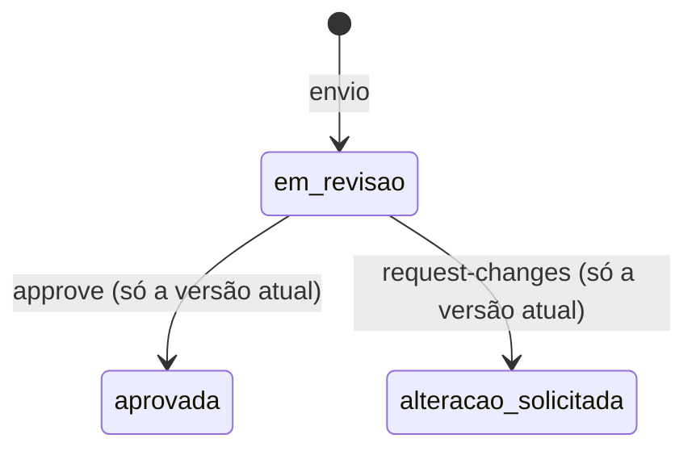
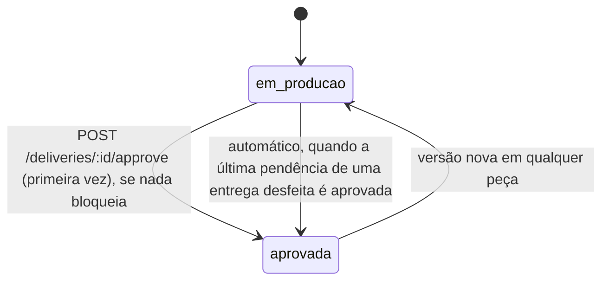

# Revisão de vídeo

API para revisar as peças de uma entrega de criador: versões numeradas, comentário preso a um segundo do vídeo e a regra de que a entrega só é aprovada (e só fica pagável) quando cada peça que a campanha exige tem a versão atual aprovada.

O modelo foi desenhado antes do código em [`docs/design.md`](docs/design.md), com entidades, estados, invariantes e a revisão do design contra cada critério do enunciado.

## Como rodar

Precisa de Node 22.13 ou mais novo (uso `node:sqlite`) e, para a carga, Docker.

```bash
npm install
npm run dev          # API em http://localhost:3000, banco em data/revisao.sqlite
npm test             # unitários + integração (sqlite em memória, relógio fixo)
npm run typecheck
npm run load         # sobe a API na porta 3106, roda k6 em Docker e confere as invariantes
```

`PORT` e `DB_PATH` mudam porta e arquivo do banco. A stack é Hono, `node:sqlite` sem ORM, zod para validar entrada, vitest e k6.

## Modelo

| Tabela | Para que serve |
| --- | --- |
| `piece_types` | catálogo: `roteiro`, `video`, `capa`, `legenda`. A coluna `timed` diz se a peça tem duração (só `video`). |
| `campaigns` + `campaign_required_pieces` | a campanha e a lista de peças que ela exige, uma linha por peça |
| `deliveries` | entrega de um criador numa campanha (`UNIQUE(campaign_id, creator_id)`), com `status` e `approval_round` |
| `piece_versions` | versões de cada peça, `UNIQUE(delivery_id, piece_type, number)`. A atual é a de maior número. |
| `delivery_changed_pieces` | peças não exigidas que receberam versão nova com a entrega aprovada e por isso passaram a bloquear |
| `comments` | comentário preso a `version_id`, com `at_second` quando a versão tem duração |
| `delivery_events` | histórico da entrega; `delivery.approved` e `delivery.approval_revoked` são os eventos que um serviço de pagamento consumiria |

Estados da versão:



Estados da entrega:



## Regras e onde vivem

| Regra do enunciado | Onde está | Teste |
| --- | --- | --- |
| Entrega só é aprovada quando cada peça exigida tem versão aprovada | `pendingPieces` em `src/domain.ts`, chamada por `approveDelivery` em `src/service.ts` | `aprovar com peça obrigatória pendente falha com erro claro listando o que falta e por quê` |
| Peça que a campanha não pediu não bloqueia | `pendingPieces` percorre só as peças de `blockingPieces` | `peça que a campanha não pediu não bloqueia, mesmo enviada e pendente` |
| Campanha só de vídeo não exige roteiro | idem | `campanha só de vídeo não exige roteiro` (unitário e integração) |
| A lista de peças exigidas é dado da campanha | tabela `campaign_required_pieces`; a função pura recebe a lista como argumento | `a lista de peças exigidas é dado da campanha e volta no GET` e `a regra depende só da lista recebida` |
| Versão nova substitui a anterior | `submitVersion`: número `max+1` na mesma transação, a anterior fica intacta | `versão nova substitui a anterior como atual e a anterior fica preservada` |
| Versão nova numa peça desfaz a aprovação até ser aprovada | `submissionRevokesApproval` e `shouldAutoReapprove` em `src/domain.ts` | `versão nova numa peça desfaz a aprovação até a nova versão ser aprovada` e `versão nova em peça não exigida também desfaz a aprovação e passa a bloquear até ser aprovada` |
| Comentário preso a um segundo, visível na versão em que foi feito | `addComment` valida `at_second` contra a duração daquela versão | `comentário preso a um segundo fica visível na versão em que foi feito` |
| Comentário não migra para a versão nova | comentário tem `version_id` fixo e a listagem é por versão | `comentário não migra sozinho para a versão nova, e o antigo segue na versão antiga` |
| Aprovar versão que já não é a atual | `review` em `src/service.ts` devolve 409 `versao_desatualizada` | `aprovar versão que já não é a atual falha com versao_desatualizada` |

O enunciado tem duas frases que parecem puxar para lados opostos quando a peça não foi pedida: "Peça que a campanha não pediu não bloqueia" e "se uma peça de uma entrega já aprovada recebe versão nova, a entrega deixa de estar aprovada até a nova versão ser aprovada". Leio as duas ao pé da letra. A primeira vale para a primeira aprovação: uma legenda enviada numa campanha que só pediu vídeo não impede aprovar. A segunda vale para qualquer peça de uma entrega já aprovada. Se a legenda recebe versão nova depois da aprovação, a entrega volta para produção e a legenda entra em `delivery_changed_pieces`, passando a bloquear até a versão nova ser aprovada. Sem isso a frase "até a nova versão ser aprovada" não teria efeito para essa peça.

Outras decisões:

- A primeira aprovação da entrega é um ato explícito (`POST /deliveries/:id/approve`). Ela libera pagamento, então alguém precisa pedir. O endpoint recalcula a regra a partir das versões atuais, e o cliente nunca escreve o status.
- Depois de desfeita, a entrega volta a `aprovada` sozinha, na transação que aprova a última versão pendente. Isso abre uma rodada nova e emite um `delivery.approved` com `automatic: true`. Chamar `approve` de novo depois disso devolve `already_approved: true` sem evento.
- Uma versão revisada não muda de decisão. Para mudar o resultado, o criador manda versão nova. Repetir a mesma decisão devolve 200 sem efeito; decisão contrária devolve 409 `transicao_invalida`.
- Comentar uma versão antiga é permitido, porque é histórico de revisão e não muda nada na entrega.
- `required_pieces` não tem endpoint de edição. Se mudasse depois da aprovação, a regra poderia quebrar sem nenhuma versão nova.
- Peça sem duração (roteiro, capa, legenda) aceita comentário sem `at_second` e recusa `duration_seconds` no envio. Vídeo exige os dois.

Erros seguem `{ "error": { "code", "message", "details?" } }`: 400 validação (`validacao`, com `details.issues` trazendo caminho e motivo de cada campo), 404 não encontrado, 409 conflito de estado (`versao_desatualizada`, `transicao_invalida`), 413 corpo grande demais, 422 regra de negócio (`pecas_pendentes`, `segundo_fora_da_duracao`).

## Validação e limites

Corpo, params e query passam por schemas zod em `src/schemas.ts`, com um único hook que converte o erro no formato acima. JSON malformado, `null`, array ou valor solto no lugar de objeto, tipo errado, string vazia ou só espaços, número negativo ou não finito e id fora do formato `[A-Za-z0-9-]{1,64}` dão 400. Campo desconhecido é descartado. O corpo só é lido com `Content-Type: application/json`; sem ele, os campos obrigatórios faltam e a resposta é 400. Limites: corpo de 64 KB (413), `required_pieces` com até 20 itens, `duration_seconds` até 21600, textos com teto de tamanho, `limit` de 1 a 500 (padrão 100) e `offset` inteiro não negativo nas listagens. Os casos estão em `test/integration/payloads-invalidos.test.ts`, que também confere que nenhum deles grava nada no banco.

## Endpoints

| Método | Rota |
| --- | --- |
| GET | `/piece-types` |
| POST | `/campaigns` |
| GET | `/campaigns/:id` |
| POST | `/campaigns/:id/deliveries` |
| GET | `/deliveries/:id` |
| POST | `/deliveries/:id/approve` |
| GET | `/deliveries/:id/events?limit=&offset=` |
| POST | `/deliveries/:id/pieces/:pieceType/versions` |
| GET | `/deliveries/:id/pieces/:pieceType/versions?limit=&offset=` |
| GET | `/versions/:id` |
| POST | `/versions/:id/approve` |
| POST | `/versions/:id/request-changes` |
| POST | `/versions/:id/comments` |
| GET | `/versions/:id/comments?limit=&offset=` |

## Exemplos reais

Rodei estas chamadas contra a API local (subi na porta 3106; nos comandos abaixo deixei a porta padrão) e colei as respostas. Abreviei os ids com `...` e, onde está marcado, cortei campos repetidos.

Campanha com as quatro peças e a entrega da criadora:

```bash
curl -s -X POST localhost:3000/campaigns -H 'content-type: application/json' \
  -d '{"name":"Lançamento tênis","required_pieces":["roteiro","video","capa","legenda"]}'
```

```json
{ "id": "b47768d6-...", "name": "Lançamento tênis", "created_at": "2026-10-10T04:09:34.062Z",
  "required_pieces": ["roteiro", "video", "capa", "legenda"] }
```

```bash
curl -s -X POST localhost:3000/campaigns/$CAMPANHA/deliveries -H 'content-type: application/json' -d '{"creator_id":"ana"}'
```

```json
{ "id": "3edb1b87-...", "status": "em_producao", "payable": false, "approval_round": 0,
  "required_pieces": ["roteiro", "video", "capa", "legenda"],
  "blocking_pieces": ["roteiro", "video", "capa", "legenda"], "ready_to_approve": false,
  "pending": [
    { "piece_type": "roteiro", "required": true, "reason": "sem_versao" },
    { "piece_type": "video", "required": true, "reason": "sem_versao" },
    { "piece_type": "capa", "required": true, "reason": "sem_versao" },
    { "piece_type": "legenda", "required": true, "reason": "sem_versao" }
  ],
  "pieces": ["(cortado)"] }
```

Envio da versão 1 do vídeo e um comentário no segundo 12,5:

```bash
curl -s -X POST localhost:3000/deliveries/$ENTREGA/pieces/video/versions -H 'content-type: application/json' \
  -d '{"url":"https://cdn.exemplo/ana/v1.mp4","duration_seconds":42}'
```

```json
{ "version": { "id": "10a06d1c-...", "piece_type": "video", "number": 1, "is_current": true,
    "url": "https://cdn.exemplo/ana/v1.mp4", "file_name": null, "duration_seconds": 42,
    "status": "em_revisao", "review_note": null, "created_at": "2026-10-10T04:09:34.419Z", "reviewed_at": null },
  "approval_revoked": false,
  "delivery": { "status": "em_producao", "payable": false, "pending": ["(cortado)"] } }
```

```bash
curl -s -X POST localhost:3000/versions/$V1/comments -H 'content-type: application/json' \
  -d '{"author":"marca","body":"logo aparece tarde","at_second":12.5}'
```

```json
{ "id": "f57aefd9-...", "version_id": "10a06d1c-...", "author": "marca", "body": "logo aparece tarde",
  "at_second": 12.5, "created_at": "2026-10-10T04:09:34.664Z" }
```

Segundo além da duração (HTTP 422):

```json
{ "error": { "code": "segundo_fora_da_duracao", "message": "at_second 50 está fora da versão v1, que dura 42s." } }
```

Com o vídeo aprovado e o resto faltando, `POST /deliveries/$ENTREGA/approve` devolve HTTP 422:

```json
{ "error": { "code": "pecas_pendentes",
    "message": "A entrega não pode ser aprovada. Peças pendentes: roteiro: nenhuma versão enviada; capa: nenhuma versão enviada; legenda: nenhuma versão enviada.",
    "details": { "pending": [
      { "piece_type": "roteiro", "required": true, "reason": "sem_versao" },
      { "piece_type": "capa", "required": true, "reason": "sem_versao" },
      { "piece_type": "legenda", "required": true, "reason": "sem_versao" } ] } } }
```

Depois de enviar e aprovar roteiro, capa e legenda, a mesma chamada aprova (HTTP 200):

```json
{ "already_approved": false,
  "delivery": { "status": "aprovada", "payable": true, "approval_round": 1,
    "approved_at": "2026-10-10T04:09:35.390Z", "ready_to_approve": true, "pending": [], "pieces": ["(cortado)"] } }
```

A versão 2 do vídeo chega e desfaz a aprovação (HTTP 201):

```json
{ "version": { "id": "454a0a48-...", "number": 2, "is_current": true, "duration_seconds": 40, "status": "em_revisao" },
  "approval_revoked": true,
  "delivery": { "status": "em_producao", "payable": false, "approval_round": 1, "approved_at": null,
    "ready_to_approve": false,
    "pending": [ { "piece_type": "video", "required": true, "reason": "versao_atual_nao_aprovada",
                   "current_version": { "id": "454a0a48-...", "number": 2, "status": "em_revisao" } } ] } }
```

Aprovar a v1, que já não é a atual (HTTP 409):

```json
{ "error": { "code": "versao_desatualizada",
    "message": "A versão v1 de video não é mais a atual (atual: v2). Revise a versão atual.",
    "details": { "current_version": { "id": "454a0a48-...", "number": 2, "status": "em_revisao" } } } }
```

O comentário ficou na v1. `GET /versions/$V2/comments` devolve `[]`, e `GET /versions/$V1/comments` ainda lista o comentário do segundo 12,5.

`POST /versions/$V2/approve` aprova a v2, e a entrega volta sozinha: `GET /deliveries/$ENTREGA` mostra `"status": "aprovada", "payable": true, "approval_round": 2`. Os eventos de ciclo de vida em `GET /deliveries/$ENTREGA/events` (filtrei os `version.*`):

```json
[ { "id": 9,  "type": "delivery.approved", "round": 1, "payload": { "automatic": false, "versions": ["(4 peças, video v1)"] } },
  { "id": 11, "type": "delivery.approval_revoked", "round": 1,
    "payload": { "reason": "nova_versao", "piece_type": "video", "required": true, "version_id": "454a0a48-...", "number": 2 } },
  { "id": 13, "type": "delivery.approved", "round": 2, "payload": { "automatic": true, "versions": ["(4 peças, video v2)"] } } ]
```

Campanha só de vídeo: com o vídeo aprovado, `approve` passa sem roteiro (HTTP 200, `"required_pieces": ["video"]`, `"status": "aprovada"`). Depois disso chega uma legenda, que a campanha não pediu (HTTP 201):

```json
{ "version": { "id": "7f57f496-...", "piece_type": "legenda", "number": 1, "file_name": "legenda.srt", "status": "em_revisao" },
  "approval_revoked": true,
  "delivery": { "status": "em_producao", "payable": false, "approval_round": 1, "approved_at": null,
    "required_pieces": ["video"], "blocking_pieces": ["video", "legenda"], "pieces": ["(cortado)"] } }
```

E `approve` agora recusa (HTTP 422):

```json
{ "error": { "code": "pecas_pendentes",
    "message": "A entrega não pode ser aprovada. Peças pendentes: legenda (não exigida, mudou depois da aprovação): versão atual v1 em revisão.",
    "details": { "pending": [ { "piece_type": "legenda", "required": false, "reason": "versao_atual_nao_aprovada",
      "current_version": { "id": "7f57f496-...", "number": 1, "status": "em_revisao" } } ] } } }
```

Payload inválido em `POST /campaigns` com `{"name":5,"required_pieces":["video",3],"extra":true}` (HTTP 400):

```json
{ "error": { "code": "validacao", "message": "name: precisa ser texto; required_pieces.1: precisa ser texto.",
    "details": { "issues": [ { "path": "name", "message": "precisa ser texto" },
                             { "path": "required_pieces.1", "message": "precisa ser texto" } ] } } }
```

Tipo de peça fora do catálogo (HTTP 400):

```json
{ "error": { "code": "tipo_de_peca_desconhecido",
    "message": "Tipo de peça desconhecido: \"trilha\". Tipos aceitos: roteiro, video, capa, legenda." } }
```

## Concorrência e idempotência

Toda escrita roda numa função síncrona dentro de `BEGIN IMMEDIATE ... COMMIT` (`transaction` em `src/db.ts`). O lock de escrita é pego antes da primeira leitura e não há `await` entre ler e gravar, então a checagem e a gravação enxergam o mesmo estado. Os casos que me preocupavam:

- Aprovar a v2 enquanto chega a v3 na mesma peça. Se o envio entra primeiro, a aprovação vê que a atual é v3 e devolve 409 `versao_desatualizada`. Se a aprovação entra primeiro, v2 fica aprovada e v3 vira a atual em revisão. O id da versão no path funciona como `expected_version`: o revisor aprova exatamente o que viu.
- Aprovar a entrega enquanto chega versão nova numa peça. Ou a checagem vê a versão em revisão e devolve 422, ou a aprovação entra e o envio a desfaz logo depois, com `delivery.approval_revoked`. Nos dois casos a entrega termina em produção.
- Várias aprovações simultâneas da mesma entrega, ou da versão que encerra a última pendência. A primeira aprova e as demais encontram a entrega já aprovada, sem evento novo. Um índice único parcial em `delivery_events (delivery_id, round) WHERE type = 'delivery.approved'` impede uma segunda emissão na mesma rodada, mesmo que algum caminho do código erre.
- Envios simultâneos na mesma peça. Cada transação calcula `max+1`, e `UNIQUE(delivery_id, piece_type, number)` garante que não se repete.
- Criar a entrega do mesmo criador duas vezes devolve a mesma (`ON CONFLICT DO NOTHING`).

Esses casos estão em `test/integration/concurrency.test.ts`, com `Promise.all`.

## Por que essa solução

Um processo Node com sqlite serializa as escritas. Para revisão de peças (pense em centenas ou milhares de entregas ativas, cada uma recebendo poucas versões por dia) isso sobra: a carga abaixo passou de 1.600 req/s numa máquina local, com p95 abaixo de 60 ms. Lock distribuído ou Redis não resolveriam nada que a transação e as restrições `UNIQUE` já não resolvem, então não usei.

Com várias instâncias da API eu trocaria o sqlite por Postgres e manteria o desenho: transação com `SELECT ... FOR UPDATE` na linha da entrega (que serializa envio, revisão e aprovação da mesma entrega), as mesmas restrições únicas e o mesmo índice parcial por rodada. O `delivery.approved` sairia por uma tabela outbox lida por um worker, e o consumidor de pagamento usaria `(delivery_id, round)` como chave de idempotência. Lock distribuído só entraria se aparecesse um efeito externo que não cabe na transação.

## Teste de carga

`npm run load` sobe a API na porta 3106 com banco num diretório temporário e roda `load/review.js` no k6 (Docker, `grafana/k6:0.54.0`). São 24 entregas (campanhas com as quatro peças, só vídeo, e vídeo com capa) e até 50 VUs por 45 s. Cada iteração sorteia uma ação: enviar versão de qualquer peça, revisar a versão atual (aprovar ou pedir alteração), aprovar a entrega, comentar no vídeo ou, em 10% das vezes, mandar um payload inválido (JSON quebrado, tipos errados, ids com unicode, query fora do limite, com e sem Content-Type). Poucas entregas para muitos clientes força disputa na mesma peça. 409 e 422 contam como respostas esperadas, desde que tragam o código certo, e o payload inválido precisa voltar 4xx no formato de erro padrão.

No fim, `scripts/verify-load.ts` lê o banco e sai com código 1 se encontrar entrega aprovada com peça bloqueante (exigida, ou não exigida que mudou depois da aprovação) sem versão atual aprovada, entrega desfeita sem pendência que não voltou a aprovada, `delivery.approved` repetido na mesma rodada, aprovações menos revogações diferente do status atual, numeração de versão com buraco ou repetição, ou comentário fora da duração. Também falha se a carga não chegou a aprovar, desfazer e reaprovar automaticamente.

Resultado de uma execução real:

```
     ✓ aprovação da entrega: 200 ou 422 pecas_pendentes
     ✓ GET entrega: 200
     ✓ envio de versão: 201
     ✓ payload inválido: nunca 5xx
     ✓ payload inválido: erro no formato padrão
     ✓ revisão de versão: 200 ou 409 conhecido
     ✓ comentário: 201

     approvals_revoked..............: 2080
     blocked_delivery_approvals.....: 10304
   ✓ checks.........................: 100.00% 76874 out of 76874
     deliveries_approved............: 22
   ✓ http_req_duration..............: avg=25ms     min=510.67µs med=17.41ms max=626.46ms p(90)=43.09ms p(95)=59.18ms
   ✓ http_req_failed................: 0.00%   0 out of 75419
     http_reqs......................: 75419   1670.183309/s
     invalid_payloads_sent..........: 5532
     stale_version_approvals........: 1325

resumo do banco após a carga: {
  entregas: 24,
  entregas_aprovadas_agora: 7,
  versoes: 15336,
  versoes_aprovadas: 8833,
  comentarios: 3999,
  eventos_delivery_approved: 2087,
  eventos_approval_revoked: 2080,
  reaprovacoes_automaticas: 2063,
  pecas_nao_exigidas_que_passaram_a_bloquear: 40
}
OK: invariantes I1 a I5 e I8 valem em todas as entregas.
```

No banco, 2087 eventos `delivery.approved` (2063 deles automáticos) menos 2080 revogações dá 7, que é o número de entregas aprovadas no fim. O contador `deliveries_approved` do k6 só conta as aprovações explícitas que ele mesmo viu responder com `already_approved: false`. 1325 tentativas de aprovar versão desatualizada foram recusadas com 409, e 5532 payloads inválidos voltaram 4xx sem nenhum 5xx.

## O que ficou de fora

- Upload de arquivo. A versão guarda uma `url` ou um `file_name` fictício; a duração vem do cliente e não é lida do arquivo.
- Autenticação e papéis (quem é marca, quem é criador). Qualquer cliente pode aprovar.
- Chave de idempotência no envio de versão. Um retry do cliente cria outra versão. Com mais tempo eu aceitaria um header `Idempotency-Key` gravado com `UNIQUE`.
- Publicação real do outbox. Os eventos ficam em `delivery_events`; não há worker lendo.
- Edição de campanha e de peças exigidas, de propósito (ver decisões).

## O que eu faria diferente com mais tempo

- Devolver total e próximo cursor nas listagens, em vez de só aceitar `limit` e `offset`.
- Separar o histórico de auditoria do outbox de pagamento, com `published_at` no outbox.
- Ler a duração real do vídeo no upload em vez de confiar no cliente.
- Comentário com intervalo (`from_second`, `to_second`) além do ponto único.

## Uso de IA

O código, os testes, o design em `docs/design.md` e este README foram produzidos com Claude Code (Claude Opus) a partir do enunciado do desafio. Os números da carga e os exemplos de resposta vêm de execuções reais.

O que eu revisei: o modelo e as decisões em aberto (primeira aprovação explícita, revogação por versão nova em qualquer peça, reaprovação automática numa rodada nova), as regras em `src/domain.ts` e `src/service.ts`, os schemas de validação e os testes de integração. Rodei `npm test`, `npm run typecheck` e `npm run load` localmente.
