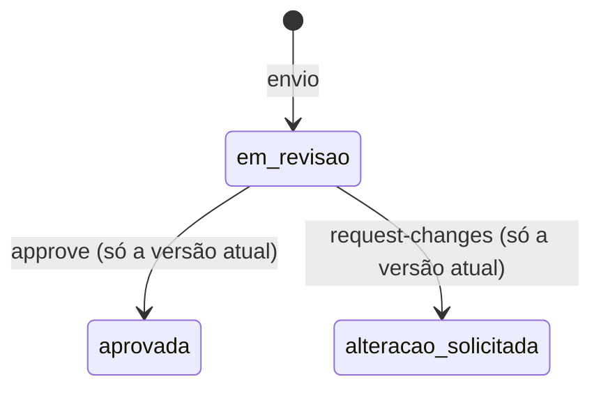
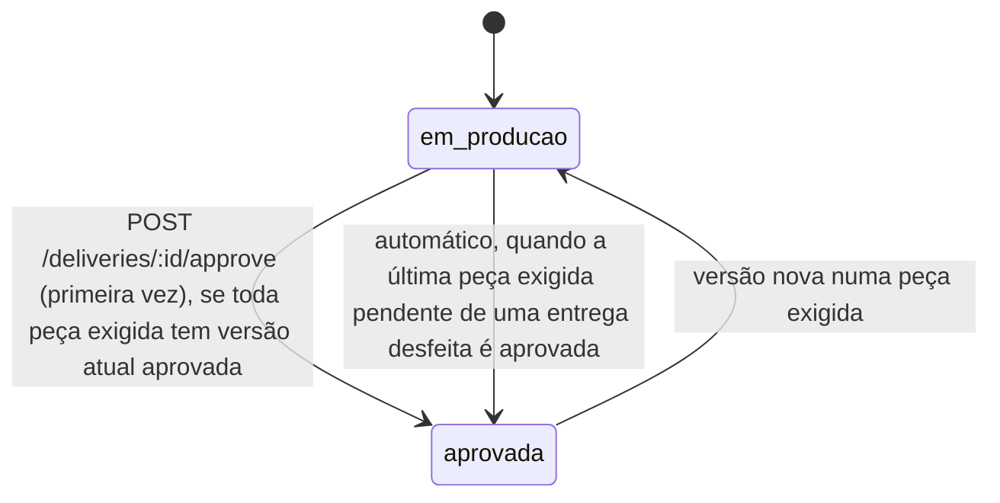

# Revisão de vídeo

API para revisar as peças de uma entrega de criador: versões numeradas, comentário preso a um segundo do vídeo e a regra de que a entrega só é aprovada (e só fica pagável) quando cada peça que a campanha exige tem a versão atual aprovada.

O modelo foi desenhado antes do código em [`docs/design.md`](docs/design.md), com entidades, estados, invariantes e a revisão do design contra cada critério do enunciado.

## Como rodar

Precisa de Node 22.13 ou mais novo (uso `node:sqlite`) e, para a carga, Docker.

```bash
npm install
npm run dev          # API em http://localhost:3000, banco em data/revisao.sqlite
npm test             # unitários, integração, propriedades e várias conexões
npm run typecheck
npm run load         # sobe a API na porta 3106, roda k6 em Docker e confere as invariantes
```

`PORT` e `DB_PATH` mudam porta e arquivo do banco. A stack é Hono, `node:sqlite` sem ORM, zod para validar entrada, vitest, fast-check e k6.

## Modelo

| Tabela | Para que serve |
| --- | --- |
| `piece_types` | catálogo: `roteiro`, `video`, `capa`, `legenda`. A coluna `timed` diz se a peça tem duração (só `video`). |
| `campaigns` + `campaign_required_pieces` | a campanha e a lista de peças que ela exige, uma linha por peça |
| `deliveries` | entrega de um criador numa campanha (`UNIQUE(campaign_id, creator_id)`), com `status` e `approval_round` |
| `piece_versions` | versões de cada peça, `UNIQUE(delivery_id, piece_type, number)`. A atual é a de maior número. |
| `comments` | comentário preso a `version_id`, com `at_second` quando a versão tem duração |
| `delivery_events` | histórico da entrega; `delivery.approved` e `delivery.approval_revoked` são os eventos que um serviço de pagamento consumiria |

Estados da versão:



Estados da entrega:



## Regras e onde vivem

| Regra do enunciado | Onde está | Teste |
| --- | --- | --- |
| Entrega só é aprovada quando cada peça exigida tem versão aprovada | `pendingPieces` em `src/domain.ts`, chamada por `approveDelivery` em `src/service.ts` | `aprovar com peça obrigatória pendente falha com erro claro listando o que falta e por quê` |
| Peça que a campanha não pediu não bloqueia | `pendingPieces` só percorre a lista exigida | `peça que a campanha não pediu não bloqueia, mesmo enviada e pendente` e `versão nova em peça não exigida não desfaz nem bloqueia a entrega aprovada` |
| Campanha só de vídeo não exige roteiro | idem | `campanha só de vídeo não exige roteiro` e `roteiro enviado depois em campanha só de vídeo não desfaz nem bloqueia, e a ordem dos envios não importa` |
| A lista de peças exigidas é dado da campanha | tabela `campaign_required_pieces`; a função pura recebe a lista como argumento | `a lista de peças exigidas é dado da campanha e volta no GET` e `a regra depende só da lista recebida` |
| Versão nova substitui a anterior | `submitVersion`: número `max+1` na mesma transação, a anterior fica intacta | `versão nova substitui a anterior como atual e a anterior fica preservada` |
| Versão nova numa peça desfaz a aprovação até ser aprovada | `submissionRevokesApproval` e `shouldAutoReapprove` em `src/domain.ts` | `versão nova numa peça desfaz a aprovação até a nova versão ser aprovada` |
| Comentário preso a um segundo, visível na versão em que foi feito | `addComment` valida `at_second` contra a duração daquela versão | `comentário preso a um segundo fica visível na versão em que foi feito` |
| Comentário não migra para a versão nova | comentário tem `version_id` fixo e a listagem é por versão | `comentário não migra sozinho para a versão nova, e o antigo segue na versão antiga` |
| Aprovar versão que já não é a atual | `review` em `src/service.ts` devolve 409 `versao_desatualizada` | `aprovar versão que já não é a atual falha com versao_desatualizada` |

Os testes ficam em `test/unit/domain.test.ts`, `test/integration/review.test.ts` e nos arquivos citados em [`docs/concorrencia-e-carga.md`](docs/concorrencia-e-carga.md).

### Qual peça desfaz a aprovação

Três frases do enunciado tratam disso: "A entrega só pode ser aprovada quando cada peça exigida tem uma versão aprovada", "Peça que a campanha não pediu não bloqueia" e "se uma peça de uma entrega já aprovada recebe versão nova, a entrega deixa de estar aprovada até a nova versão ser aprovada". Leio o "uma peça" da terceira como uma das peças que contam para a aprovação, ou seja, as exigidas. Na outra leitura, uma campanha só de vídeo já aprovada que recebe uma legenda (ou um roteiro), e tem essa legenda recusada, ficaria travada por uma peça que a campanha não pediu. Isso contradiz "não bloqueia" e "Campanha só de vídeo não exige roteiro", e o resultado ainda dependeria da ordem dos envios. Por isso versão nova em peça não exigida não desfaz nem bloqueia, em nenhum momento.

Outras decisões:

- A primeira aprovação da entrega é um ato explícito (`POST /deliveries/:id/approve`). Ela libera pagamento, então alguém precisa pedir. O endpoint recalcula a regra a partir das versões atuais, e o cliente nunca escreve o status.
- Depois de desfeita, a entrega volta a `aprovada` sozinha, na transação que aprova a última peça exigida pendente. É o "até a nova versão ser aprovada" do enunciado. Isso abre uma rodada nova e emite um `delivery.approved` com `automatic: true`. Chamar `approve` depois disso devolve `already_approved: true` sem evento.
- Uma versão revisada não muda de decisão. Para mudar o resultado, o criador manda versão nova. Repetir a mesma decisão devolve 200 sem efeito; decisão contrária devolve 409 `transicao_invalida`.
- Comentar uma versão antiga é permitido, porque é histórico de revisão e não muda nada na entrega.
- `required_pieces` não tem endpoint de edição. Se mudasse depois da aprovação, a regra poderia quebrar sem nenhuma versão nova.
- Peça sem duração (roteiro, capa, legenda) aceita comentário sem `at_second` e recusa `duration_seconds` no envio. Vídeo exige os dois.

Erros seguem `{ "error": { "code", "message", "details?" } }`: 400 validação (`validacao`, com `details.issues` trazendo caminho e motivo de cada campo), 404 não encontrado, 409 conflito de estado (`versao_desatualizada`, `transicao_invalida`), 413 corpo grande demais, 415 Content-Type que não é JSON, 422 regra de negócio (`pecas_pendentes`, `segundo_fora_da_duracao`).

## Endpoints

| Método | Rota |
| --- | --- |
| GET | `/piece-types` |
| POST | `/campaigns` |
| GET | `/campaigns/:id` |
| POST | `/campaigns/:id/deliveries` |
| GET | `/deliveries/:id` |
| POST | `/deliveries/:id/approve` |
| GET | `/deliveries/:id/events?limit=&offset=` |
| POST | `/deliveries/:id/pieces/:pieceType/versions` |
| GET | `/deliveries/:id/pieces/:pieceType/versions?limit=&offset=` |
| GET | `/versions/:id` |
| POST | `/versions/:id/approve` |
| POST | `/versions/:id/request-changes` |
| POST | `/versions/:id/comments` |
| GET | `/versions/:id/comments?limit=&offset=` |

## Exemplos reais

Rodei estas chamadas contra a API local (subi na porta 3106; nos comandos abaixo deixei a porta padrão) e colei as respostas. Abreviei os ids com `...` e, onde está marcado, cortei campos repetidos.

Campanha com as quatro peças e a entrega da criadora:

```bash
curl -s -X POST localhost:3000/campaigns -H 'content-type: application/json' \
  -d '{"name":"Lançamento tênis","required_pieces":["roteiro","video","capa","legenda"]}'
```

```json
{ "id": "f75136dc-...", "name": "Lançamento tênis", "created_at": "2026-10-10T04:20:41.662Z",
  "required_pieces": ["roteiro", "video", "capa", "legenda"] }
```

```bash
curl -s -X POST localhost:3000/campaigns/$CAMPANHA/deliveries -H 'content-type: application/json' -d '{"creator_id":"ana"}'
```

```json
{ "id": "3e021474-...", "status": "em_producao", "payable": false, "approval_round": 0,
  "required_pieces": ["roteiro", "video", "capa", "legenda"], "ready_to_approve": false,
  "pending": [
    { "piece_type": "roteiro", "reason": "sem_versao" },
    { "piece_type": "video", "reason": "sem_versao" },
    { "piece_type": "capa", "reason": "sem_versao" },
    { "piece_type": "legenda", "reason": "sem_versao" }
  ],
  "pieces": ["(cortado)"] }
```

Envio da versão 1 do vídeo e um comentário no segundo 12,5:

```bash
curl -s -X POST localhost:3000/deliveries/$ENTREGA/pieces/video/versions -H 'content-type: application/json' \
  -d '{"url":"https://cdn.exemplo/ana/v1.mp4","duration_seconds":42}'
```

```json
{ "version": { "id": "beb71b16-...", "piece_type": "video", "number": 1, "is_current": true,
    "url": "https://cdn.exemplo/ana/v1.mp4", "file_name": null, "duration_seconds": 42,
    "status": "em_revisao", "review_note": null, "created_at": "2026-10-10T04:20:41.819Z", "reviewed_at": null },
  "approval_revoked": false,
  "delivery": { "status": "em_producao", "payable": false, "pending": ["(cortado)"] } }
```

```bash
curl -s -X POST localhost:3000/versions/$V1/comments -H 'content-type: application/json' \
  -d '{"author":"marca","body":"logo aparece tarde","at_second":12.5}'
```

```json
{ "id": "c7b9ca7c-...", "version_id": "beb71b16-...", "author": "marca", "body": "logo aparece tarde",
  "at_second": 12.5, "created_at": "2026-10-10T04:20:41.902Z" }
```

Segundo além da duração (HTTP 422):

```json
{ "error": { "code": "segundo_fora_da_duracao", "message": "at_second 50 está fora da versão v1, que dura 42s." } }
```

Com o vídeo aprovado e o resto faltando, `POST /deliveries/$ENTREGA/approve` devolve HTTP 422:

```json
{ "error": { "code": "pecas_pendentes",
    "message": "A entrega não pode ser aprovada. Peças exigidas pendentes: roteiro: nenhuma versão enviada; capa: nenhuma versão enviada; legenda: nenhuma versão enviada.",
    "details": { "pending": [
      { "piece_type": "roteiro", "reason": "sem_versao" },
      { "piece_type": "capa", "reason": "sem_versao" },
      { "piece_type": "legenda", "reason": "sem_versao" } ] } } }
```

Depois de enviar e aprovar roteiro, capa e legenda, a mesma chamada aprova (HTTP 200):

```json
{ "already_approved": false,
  "delivery": { "status": "aprovada", "payable": true, "approval_round": 1,
    "approved_at": "2026-10-10T04:20:42.242Z", "ready_to_approve": true, "pending": [], "pieces": ["(cortado)"] } }
```

A versão 2 do vídeo chega e desfaz a aprovação (HTTP 201):

```json
{ "version": { "id": "0e95890c-...", "number": 2, "is_current": true, "duration_seconds": 40, "status": "em_revisao" },
  "approval_revoked": true,
  "delivery": { "status": "em_producao", "payable": false, "approval_round": 1, "approved_at": null,
    "ready_to_approve": false,
    "pending": [ { "piece_type": "video", "reason": "versao_atual_nao_aprovada",
                   "current_version": { "id": "0e95890c-...", "number": 2, "status": "em_revisao" } } ] } }
```

Aprovar a v1, que já não é a atual (HTTP 409):

```json
{ "error": { "code": "versao_desatualizada",
    "message": "A versão v1 de video não é mais a atual (atual: v2). Revise a versão atual.",
    "details": { "current_version": { "id": "0e95890c-...", "number": 2, "status": "em_revisao" } } } }
```

O comentário ficou na v1. `GET /versions/$V2/comments` devolve `[]`, e `GET /versions/$V1/comments` ainda lista o comentário do segundo 12,5.

`POST /versions/$V2/approve` aprova a v2, e a entrega volta sozinha: `GET /deliveries/$ENTREGA` mostra `"status": "aprovada", "payable": true, "approval_round": 2`. Os eventos de ciclo de vida em `GET /deliveries/$ENTREGA/events` (filtrei os `version.*`):

```json
[ { "id": 9,  "type": "delivery.approved", "round": 1, "payload": { "automatic": false, "versions": ["(4 peças, video v1)"] } },
  { "id": 11, "type": "delivery.approval_revoked", "round": 1,
    "payload": { "reason": "nova_versao", "piece_type": "video", "version_id": "0e95890c-...", "number": 2 } },
  { "id": 13, "type": "delivery.approved", "round": 2, "payload": { "automatic": true, "versions": ["(4 peças, video v2)"] } } ]
```

Campanha só de vídeo: com o vídeo aprovado, `approve` passa sem roteiro (HTTP 200, `"required_pieces": ["video"]`, `"status": "aprovada"`). Depois chega uma legenda, que a campanha não pediu (HTTP 201):

```json
{ "version": { "id": "d476db09-...", "piece_type": "legenda", "number": 1, "file_name": "legenda.srt", "status": "em_revisao" },
  "approval_revoked": false,
  "delivery": { "status": "aprovada", "payable": true, "approval_round": 1, "pieces": ["(cortado)"] } }
```

A marca pede alteração na legenda (`"status": "alteracao_solicitada"`, `"review_note": "erro de digitação"`) e a entrega continua aprovada. `POST /deliveries/$ENTREGA/approve` devolve HTTP 200:

```json
{ "already_approved": true,
  "delivery": { "status": "aprovada", "payable": true, "approval_round": 1, "approved_at": "2026-10-10T04:20:42.779Z", "pieces": ["(cortado)"] } }
```

Payload inválido em `POST /campaigns` com `{"name":5,"required_pieces":["video",3],"extra":true}` (HTTP 400):

```json
{ "error": { "code": "validacao", "message": "name: precisa ser texto; required_pieces.1: precisa ser texto; extra: campo não aceito.",
    "details": { "issues": [ { "path": "name", "message": "precisa ser texto" },
                             { "path": "required_pieces.1", "message": "precisa ser texto" },
                             { "path": "extra", "message": "campo não aceito" } ] } } }
```

Comentário com `at_second: -1` é erro de formato (HTTP 400); com `at_second: 50` num vídeo de 42 s é regra da versão (HTTP 422):

```json
{ "error": { "code": "validacao", "message": "at_second: precisa ser no mínimo 0.",
    "details": { "issues": [ { "path": "at_second", "message": "precisa ser no mínimo 0" } ] } } }
```

```json
{ "error": { "code": "segundo_fora_da_duracao", "message": "at_second 50 está fora da versão v1, que dura 42s." } }
```

O mesmo `POST /campaigns` sem `Content-Type` (HTTP 415):

```json
{ "error": { "code": "content_type_invalido", "message": "Envie o corpo como JSON, com Content-Type: application/json." } }
```

Tipo de peça fora do catálogo (HTTP 400):

```json
{ "error": { "code": "tipo_de_peca_desconhecido",
    "message": "Tipo de peça desconhecido: \"trilha\". Tipos aceitos: roteiro, video, capa, legenda." } }
```

## Validação, concorrência e carga

Toda entrada passa por schemas zod (`src/schemas.ts`); corpo com campo desconhecido, tipo errado ou Content-Type que não é JSON é recusado (400 ou 415) sem gravar nada. Toda escrita roda dentro de `BEGIN IMMEDIATE`, com restrições `UNIQUE` e um índice único parcial que garante um `delivery.approved` por rodada. A carga com k6 (`npm run load`) mistura envios, revisões, aprovações e payloads inválidos em poucas entregas e confere as invariantes no banco no fim. Os detalhes, a justificativa de sqlite nesta escala e os números reais da carga estão em [`docs/concorrencia-e-carga.md`](docs/concorrencia-e-carga.md).

## O que ficou de fora

- Upload de arquivo. A versão guarda uma `url` ou um `file_name` fictício; a duração vem do cliente e não é lida do arquivo.
- Autenticação e papéis (quem é marca, quem é criador). Qualquer cliente pode aprovar. Pensei num header `X-Ator: marca|criador` com 403 para o criador que tenta aprovar, mas sem autenticação o cliente declara o próprio papel, então ele só daria aparência de controle; preferi deixar de fora até existir identidade de verdade.
- Chave de idempotência no envio de versão. Um retry do cliente cria outra versão. Com mais tempo eu aceitaria um header `Idempotency-Key` gravado com `UNIQUE`.
- Publicação real do outbox. Os eventos ficam em `delivery_events`; não há worker lendo.
- Edição de campanha e de peças exigidas, de propósito (ver decisões).

## O que eu faria diferente com mais tempo

- Devolver total e próximo cursor nas listagens, em vez de só aceitar `limit` e `offset`.
- Separar o histórico de auditoria do outbox de pagamento, com `published_at` no outbox.
- Ler a duração real do vídeo no upload em vez de confiar no cliente.
- Comentário com intervalo (`from_second`, `to_second`) além do ponto único.

## Uso de IA

O código, os testes, o design em `docs/design.md` e este README foram produzidos com Claude Code (Claude Opus) a partir do enunciado do desafio. Os números da carga e os exemplos de resposta vêm de execuções reais.

O que eu revisei: o modelo e as decisões em aberto (primeira aprovação explícita, revogação só por versão nova em peça exigida, reaprovação automática numa rodada nova), as regras em `src/domain.ts` e `src/service.ts`, os schemas de validação e os testes de integração, de propriedade e de várias conexões. Rodei `npm test`, `npm run typecheck` e `npm run load` localmente.
