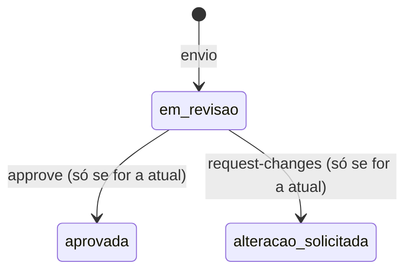
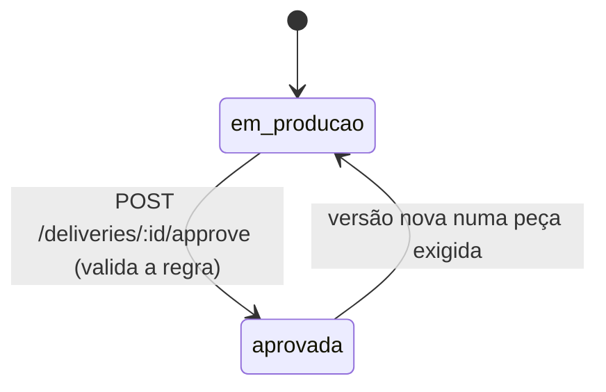

# Design: revisão de vídeo e aprovação da entrega

Escrevi este documento antes do código. Ele fixa o modelo, os estados, as invariantes e os endpoints, e no fim confronta cada item do enunciado com o que o modelo garante.

## Vocabulário

- **Campanha**: o que a marca comprou. Declara a lista de peças exigidas.
- **Tipo de peça**: catálogo fixo (`roteiro`, `video`, `capa`, `legenda`). Cada tipo diz se tem duração (`timed`). Só `video` tem.
- **Entrega**: o trabalho de um criador numa campanha. Uma por par (campanha, criador).
- **Versão**: um envio de uma peça dentro de uma entrega. Numerada a partir de 1 por (entrega, peça). A de maior número é a **versão atual**.
- **Comentário**: nota de revisão presa a uma versão. Em versão com duração, ancorado num segundo.
- **Evento**: histórico append-only da entrega. Os eventos `delivery.approved` e `delivery.approval_revoked` são os que um serviço de pagamento consumiria (outbox).

## Tabelas

```
piece_types(code PK, label, timed 0|1)
campaigns(id PK, name, created_at)
campaign_required_pieces(campaign_id FK, piece_type FK -> piece_types, PK(campaign_id, piece_type))
deliveries(id PK, campaign_id FK, creator_id, status, approval_round, approved_at, created_at,
           UNIQUE(campaign_id, creator_id))
piece_versions(id PK, delivery_id FK, piece_type FK, number, url, file_name, duration_seconds,
               status, review_note, created_at, reviewed_at,
               UNIQUE(delivery_id, piece_type, number))
comments(id PK, version_id FK, author, body, at_second, created_at)
delivery_events(id PK autoincrement, delivery_id FK, type, round, payload JSON, created_at)
  UNIQUE INDEX (delivery_id, round) WHERE type = 'delivery.approved'
  UNIQUE INDEX (delivery_id, round) WHERE type = 'delivery.approval_revoked'
```

A lista de peças exigidas é linha em `campaign_required_pieces`. O código nunca pergunta "é vídeo?" para decidir se algo bloqueia: ele lê essa tabela. O único atributo por tipo que o código consulta é `piece_types.timed`, que decide se a versão precisa de `duration_seconds` e se o comentário precisa de `at_second`.

## Estados

Versão:



`aprovada` e `alteracao_solicitada` são finais para aquela versão. Para mudar o resultado, o criador manda versão nova. Repetir a mesma decisão sobre a mesma versão devolve 200 sem efeito (idempotente). Decisão contrária devolve 409 `transicao_invalida`.

Entrega:



## Invariantes

1. **I1**: entrega `aprovada` implica que toda peça exigida tem versão atual com status `aprovada`.
2. **I2**: números de versão por (entrega, peça) são 1..n, sem buraco nem repetição. Garantido por `UNIQUE` e por calcular `max+1` dentro da mesma transação.
3. **I3**: no máximo um `delivery.approved` por rodada de aprovação. `approval_round` incrementa a cada aprovação e o índice único parcial impede repetir a rodada.
4. **I4**: para cada entrega, `#approved - #revoked` é 1 se ela está aprovada e 0 se não está.
5. **I5**: comentário pertence a uma versão e nunca muda de versão. `at_second` fica entre 0 e `duration_seconds` daquela versão.
6. **I6**: conteúdo da versão (url, arquivo, duração, número) é imutável. Só o status de revisão muda, e só uma vez.
7. **I7**: `required_pieces` de uma campanha não muda depois de criada (não há endpoint de edição). Se mudasse, I1 poderia quebrar sem nenhuma versão nova.

## Decisões

- **Aprovação da entrega é um ato explícito** (`POST /deliveries/:id/approve`). Ela libera pagamento, então quero que alguém peça. O endpoint recalcula a regra a partir das versões atuais; o status gravado é consequência dessa checagem, nunca um campo que o cliente escreve.
- **Pendência gera 422 `pecas_pendentes`** com `details.pending`, uma linha por peça exigida que falta, com o motivo `sem_versao` ou `versao_atual_nao_aprovada` (este último traz número e status da versão atual).
- **Reaprovar entrega já aprovada** devolve 200 com o estado atual e não emite evento novo.
- **Versão nova numa peça exigida de entrega aprovada** volta a entrega para `em_producao`, zera `approved_at` e grava `delivery.approval_revoked` com a mesma rodada da aprovação desfeita. Para voltar a `aprovada` é preciso aprovar a versão nova e chamar `approve` de novo, o que abre a rodada seguinte e emite outro `delivery.approved`.
- **Versão nova numa peça não exigida não desfaz a aprovação.** Peça não exigida não bloqueia a aprovação, então desfazer por causa dela abriria uma reaprovação que passaria sem olhar a versão nova. Fica registrado o evento `version.submitted`, como qualquer envio.
- **`payable`** é `status === 'aprovada'`, exposto no GET da entrega.
- **Aprovar ou pedir alteração numa versão que não é a atual** devolve 409 `versao_desatualizada`, com o número da versão atual em `details`. O id da versão é o "expected version": o cliente aprova exatamente o que viu.
- **Comentário não migra.** Comentários são listados por `version_id`. Versão nova começa com lista vazia, e a antiga continua com os dela. Comentar versão antiga é permitido (é histórico de revisão, não decisão).
- **Peça desconhecida** (fora de `piece_types`) é 400 `tipo_de_peca_desconhecido`, tanto na campanha quanto no envio.

## Concorrência

O servidor é um processo Node com `node:sqlite` síncrono. Toda operação de escrita roda numa função síncrona dentro de `BEGIN IMMEDIATE ... COMMIT`, que pega o lock de escrita antes de ler. Não existe `await` entre a leitura e a escrita. Os casos críticos:

- *Aprovar versão v2 enquanto chega v3 na mesma peça*: se o envio entra primeiro, a aprovação lê que a atual é v3 e devolve 409. Se a aprovação entra primeiro, v2 fica aprovada e v3 vira a atual em revisão (e, se a entrega estava aprovada, a aprovação é desfeita).
- *Aprovar entrega enquanto chega versão nova*: se o envio entra primeiro, a checagem vê a versão em revisão e devolve 422. Se a aprovação entra primeiro, o envio a desfaz. Nos dois casos I1 vale no fim.
- *Duas aprovações da entrega ao mesmo tempo*: a segunda vê `aprovada` e devolve 200 sem evento. O índice único parcial é a rede de segurança se algum caminho errar.
- *Dois envios na mesma peça*: cada um calcula `max+1` dentro da própria transação, então saem v(n+1) e v(n+2).

## Endpoints

| Método | Rota | O que faz |
| --- | --- | --- |
| GET | `/piece-types` | catálogo de tipos |
| POST | `/campaigns` | cria campanha com `required_pieces` |
| GET | `/campaigns/:id` | campanha e peças exigidas |
| POST | `/campaigns/:id/deliveries` | cria (ou devolve) a entrega do criador |
| GET | `/deliveries/:id` | estado, `payable`, peças, versão atual de cada uma, pendências |
| POST | `/deliveries/:id/pieces/:pieceType/versions` | envia versão nova |
| GET | `/deliveries/:id/pieces/:pieceType/versions` | histórico de versões da peça |
| GET | `/versions/:id` | uma versão |
| POST | `/versions/:id/approve` | aprova a versão (precisa ser a atual) |
| POST | `/versions/:id/request-changes` | pede alteração (precisa ser a atual) |
| POST | `/versions/:id/comments` | comenta em `at_second` |
| GET | `/versions/:id/comments` | comentários daquela versão, por segundo |
| POST | `/deliveries/:id/approve` | aprova a entrega se a regra deixar |
| GET | `/deliveries/:id/events` | histórico da entrega |

## Revisão do design contra o enunciado

| Item | Como o modelo atende |
| --- | --- |
| Aprovar com peça obrigatória pendente falha com erro claro | 422 `pecas_pendentes` com lista por peça e motivo |
| Versão nova desfaz a aprovação até ser aprovada | envio em peça exigida volta a entrega para `em_producao`; reaprovação exige versão atual aprovada |
| Campanha só de vídeo não exige roteiro | a regra percorre só `campaign_required_pieces`; campanha `["video"]` aprova sem roteiro |
| Comentário não migra | comentário tem `version_id` fixo; versão nova nasce sem comentários |
| Lista de peças exigidas é dado | tabela `campaign_required_pieces`; a função pura recebe a lista como argumento |
| Comentário preso a um segundo, visível na versão | `at_second` validado contra a duração daquela versão; listagem por versão |
| Versão que substitui a anterior | `number` crescente; atual é a de maior número; anteriores continuam consultáveis |
| Peça não pedida não bloqueia | a função pura ignora peças fora da lista |
| Nada de arquivo dirigido a ferramenta | o repositório não tem AGENTS.md, CLAUDE.md nem regra de editor |

Ponto que conferi duas vezes: I1 só pode quebrar se (a) a versão atual de uma peça exigida mudar, (b) o status de uma versão atual aprovada mudar ou (c) a lista de exigidas mudar. (a) é tratado no envio, (b) é impossível pela máquina de estados da versão e (c) é impossível porque não há edição de campanha.
